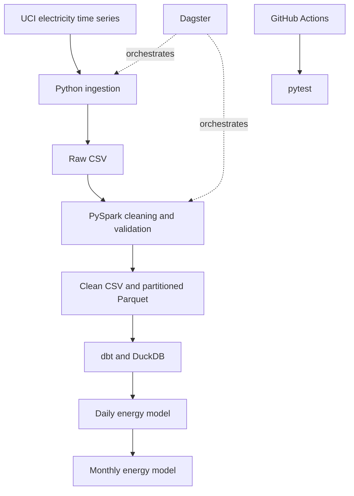

# Architecture

The pipeline separates ingestion, transformation and analytics modelling. Parquet is retained
for columnar processing; CSV provides a simple local hand-off to dbt-duckdb. A generated sample
allows a quick smoke test before downloading the full dataset.
